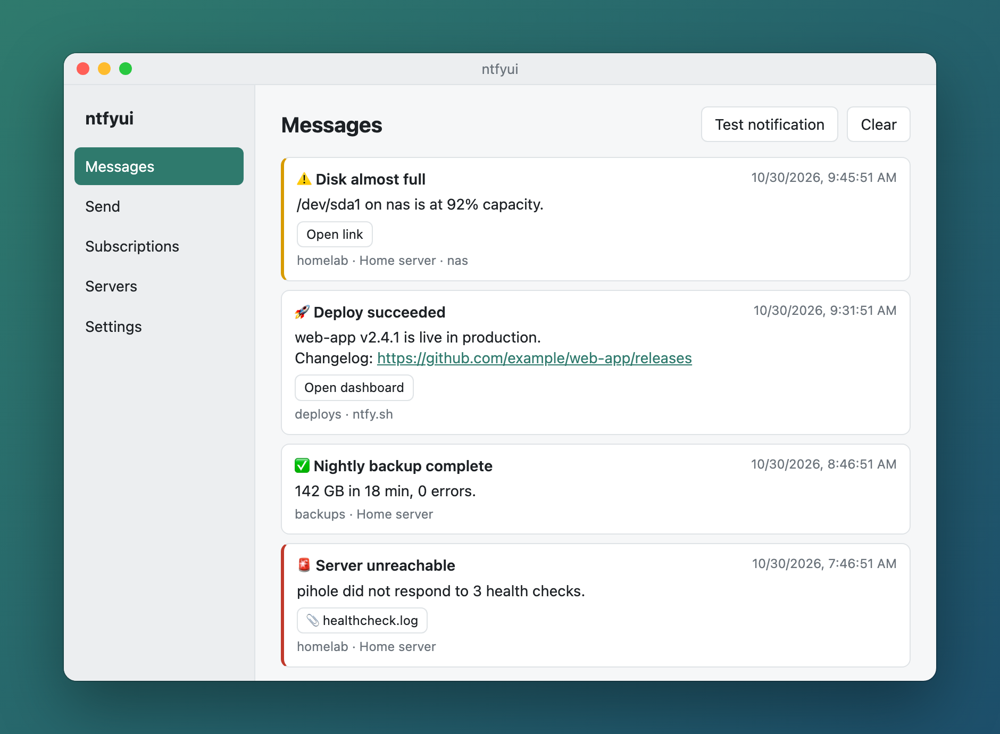
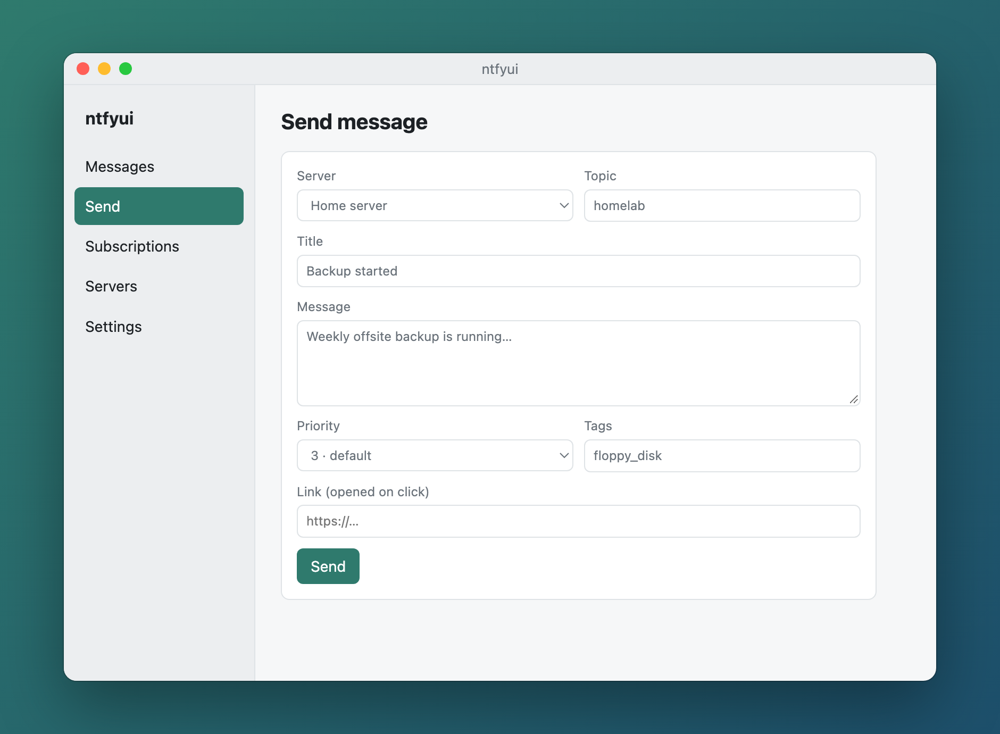
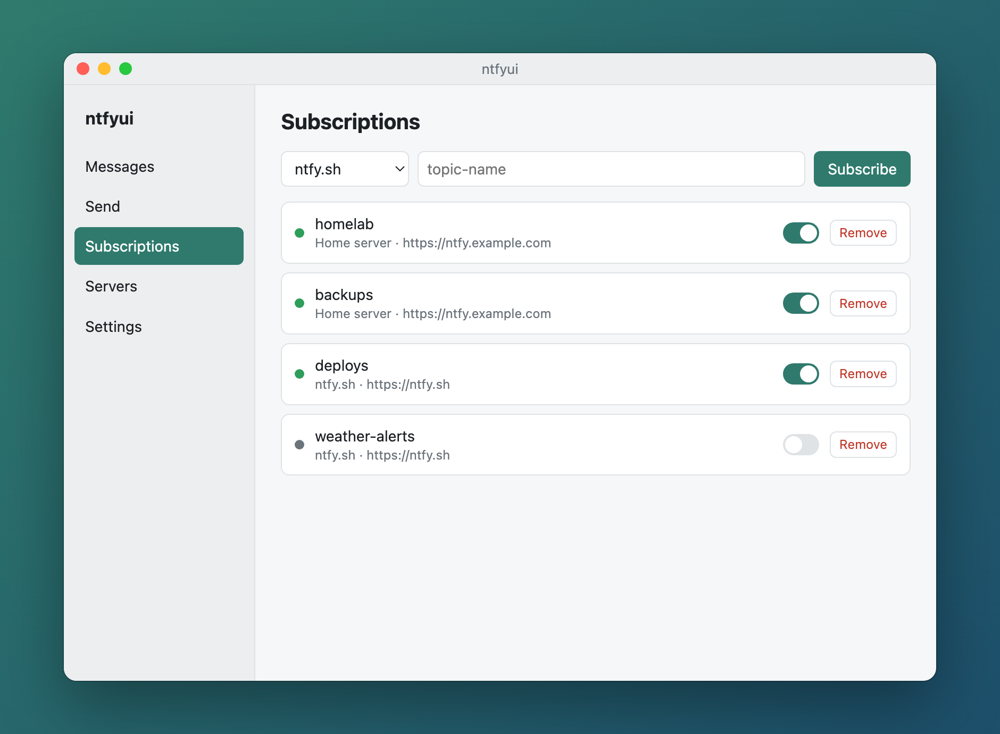
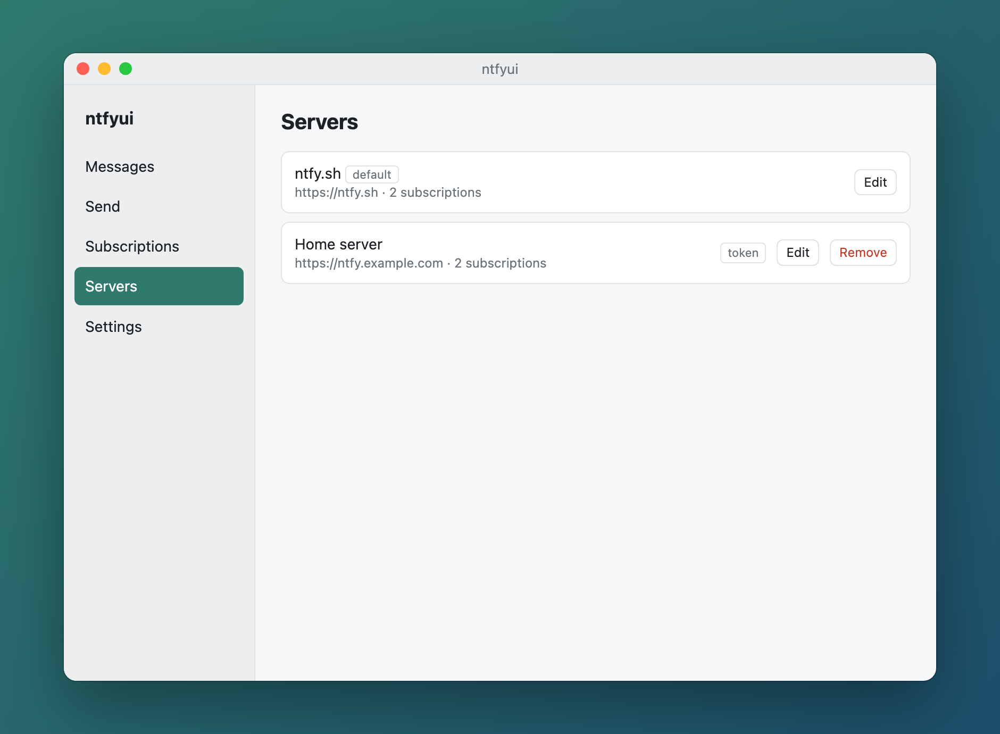
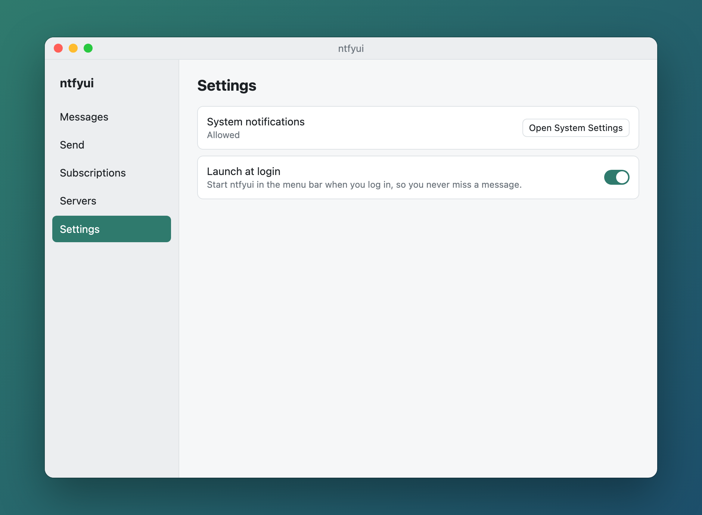
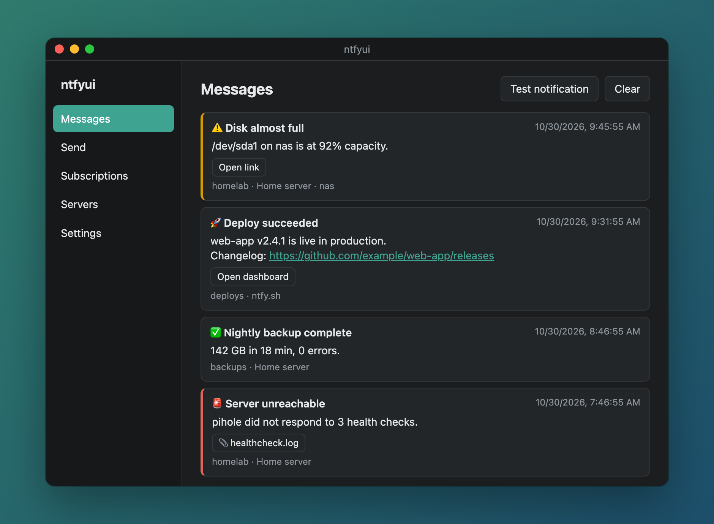

<p align="center">
  
</p>

<h1 align="center">ntfyui</h1>

<p align="center">
  A small desktop client for <a href="https://ntfy.sh">ntfy</a>: subscribe to topics on ntfy.sh
  or your own server and get native system notifications.
</p>

<p align="center">
  <a href="https://github.com/CT3/ntfyui/actions/workflows/build.yml"></a>
  <a href="https://github.com/CT3/ntfyui/actions/workflows/check.yml"></a>
  <a href="LICENSE"></a>
</p>

<p align="center">
  
</p>

## Features

- **Native notifications** – messages pop up as system notifications. On macOS clicking one
  opens the message's link.
- **ntfy.sh and self-hosted servers** – with no auth, username/password or access tokens.
- **Never miss a message** – reconnects automatically and catches up on anything sent while
  you were offline or the app was closed.
- **Message history** – the last 200 messages, with clickable links, action buttons,
  attachments, priorities and emoji tags.
- **Send messages** – publish to any topic with a title, priority, tags and a click link.
- **Lives in the menu bar / tray** – closing the window keeps it running, and it can launch
  at login.
- **Light and dark mode**, following your system.

| Send | Subscriptions |
| --- | --- |
|  |  |
| **Servers** | **Settings** |
|  |  |

<p align="center">
  
</p>

## Install

Download the latest build for your platform from
[Releases](https://github.com/CT3/ntfyui/releases):

| Platform | File |
| --- | --- |
| macOS (Apple Silicon / Intel) | `.dmg` |
| Windows | `.msi` or `-setup.exe` |
| Linux | `.AppImage`, `.deb` or `.rpm` |

The builds aren't signed with a paid developer certificate yet, so your OS will warn you the
first time:

- **macOS** – right-click the app → **Open**, or run `xattr -cr /Applications/ntfyui.app`.
  Then allow notifications when asked (or in System Settings → Notifications → ntfyui).
- **Windows** – SmartScreen: **More info** → **Run anyway**.

> macOS is the main, tested platform. Windows and Linux builds are produced by CI but have
> seen less real-world use – issues and feedback are welcome.

## Usage

1. **Servers** – ntfy.sh is set up by default. Add your own server with its URL and, if
   needed, a username/password or access token.
2. **Subscriptions** – pick a server, enter a topic name and hit **Subscribe**. The dot shows
   the connection state (green = connected).
3. That's it – new messages appear as notifications and on the **Messages** tab.

Try it with ntfy.sh:

```sh
curl -H "Title: Hello" -H "Tags: tada" -d "It works!" https://ntfy.sh/<your-topic>
```

Settings and history are stored in your OS's app data folder
(`~/Library/Application Support/com.ntfyui.desktop/` on macOS). Passwords and tokens are
stored there in plain text, readable only by your user.

## Development

Requirements: [Rust](https://rustup.rs), Node.js 18+, and the
[Tauri prerequisites](https://v2.tauri.app/start/prerequisites/) for your OS.

```sh
npm install
npm run dev          # run the app in development mode
npm run build        # build installers for the current OS into src-tauri/target/release/bundle/
npm run screenshots  # regenerate docs/screenshots (needs Google Chrome)
```

```sh
cd src-tauri && cargo fmt && cargo clippy && cargo test
```

On macOS, native notifications only work from the bundled app (`npm run build`, then open
the `.app`), not from `npm run dev`.

### Project layout

```
src/                     UI – plain HTML/CSS/JS, no build step
  emoji.json             tag → emoji map, shared with the backend
src-tauri/src/
  lib.rs                 app setup, tray, Tauri commands
  ntfy.rs                subscription streams, reconnects, incoming messages
  config.rs              servers & subscriptions (config.json)
  history.rs             message history (messages.json)
  macos_notify.rs        native macOS notifications (UNUserNotificationCenter)
scripts/screenshots.sh   renders README screenshots with sample data
```

### How it works

Each enabled subscription keeps one long-lived HTTP stream open to
`<server>/<topic>/json`. ntfy sends a keepalive every ~45 s, so 90 s of silence is treated
as a dead connection. On reconnect (or app start) the stream resumes with
`?since=<last message id>`, and duplicates are dropped.

On macOS, notifications go through `UNUserNotificationCenter` directly, because the Tauri
notification plugin uses the deprecated `NSUserNotificationCenter`, which recent macOS
versions ignore. Other platforms use
[tauri-plugin-notification](https://v2.tauri.app/plugin/notification/).

### Releasing

Bump the version in `package.json`, `src-tauri/Cargo.toml` and `src-tauri/tauri.conf.json`,
then push a tag:

```sh
git tag v0.2.0 && git push origin v0.2.0
```

CI builds macOS (arm64 + x64), Linux and Windows and attaches the installers to a draft
GitHub release.

## License

[MIT](LICENSE)
